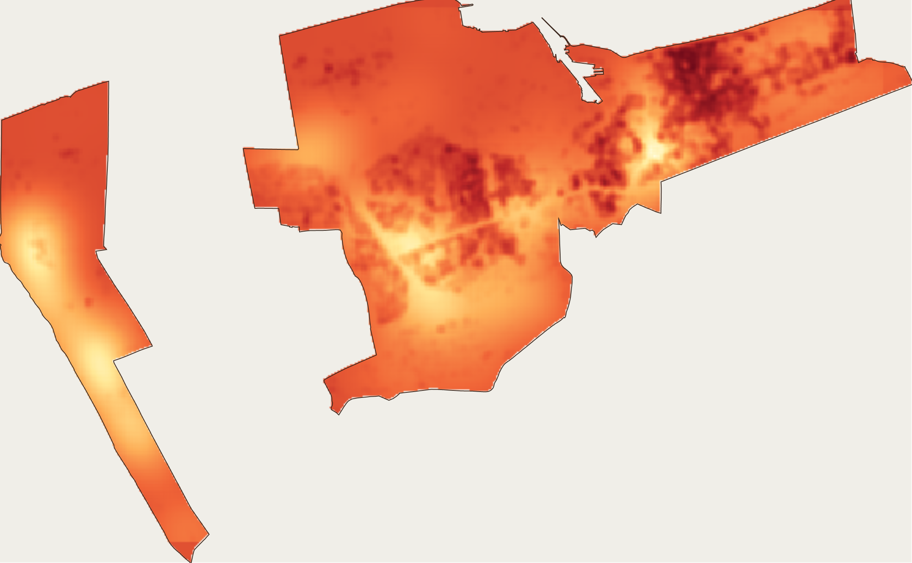
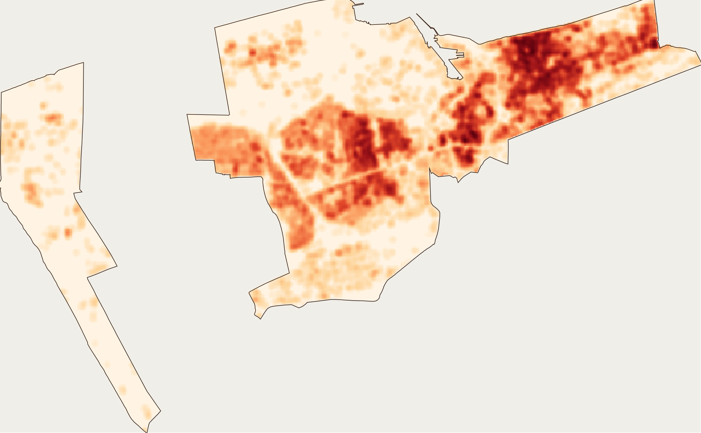
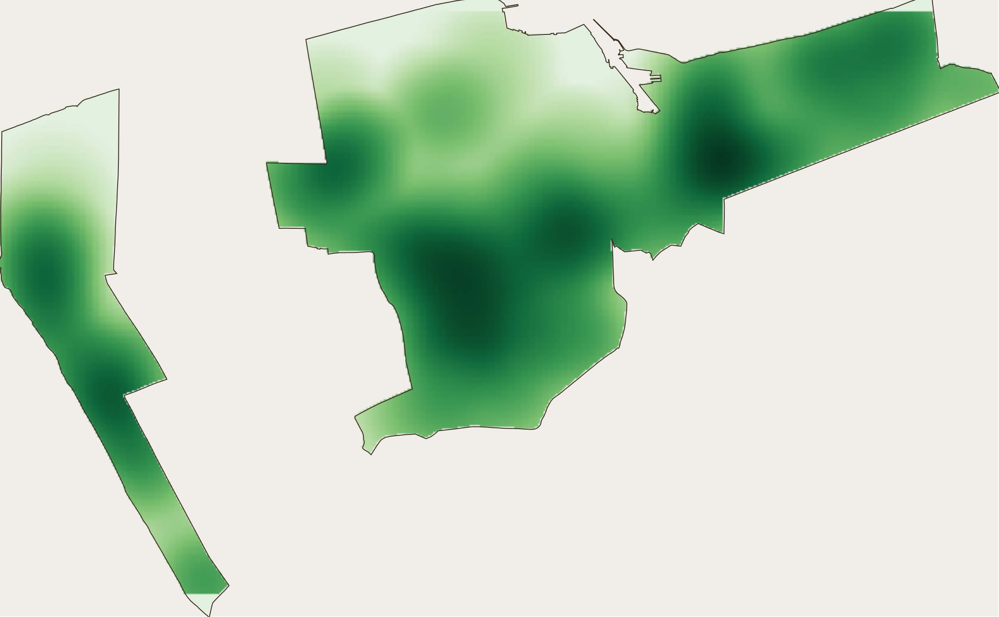
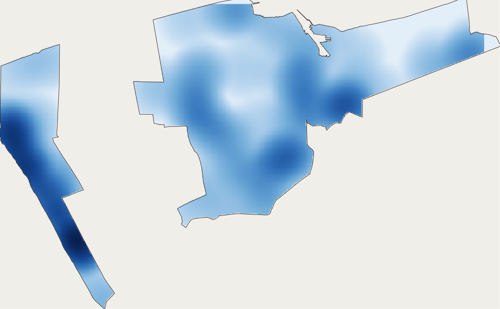

# UR06 — Sensibilité de Dunkerque aux phénomènes caniculaires

**UV UR06 « Géomatique » — Université de Technologie de Compiègne — A23**
Étude spatiale de la vulnérabilité d'un territoire aux canicules, réalisée avec **ArcGIS** (modules vectoriel + raster), sans données météorologiques et sans couche d'îlot de chaleur préconstruite.



*Indice de sensibilité reconstitué à partir des trois gradients (bâti, végétation, eau). Carte régénérée depuis les rasters du projet — voir [Limites et avertissements](#limites-et-avertissements).*

**[中文 ↓](#中文) · [Français ↓](#français)**

---

## 中文

### 一句话

把"城市为什么热"拆成三个可计算的连续场——**建筑致热、植被降温、水体降温**——用**核密度**生成梯度面，再用**多准则分析（AMC）**加权合成一张敏感性地图。研究对象是上法兰西大区的**敦刻尔克**。

### 结果

三幅梯度图的实测统计（数值直接读自随栅格交付的 `.aux.xml`）：

| 栅格 | 像元 | 最大值 | 平均值 | 含义 |
|---|---|---|---|---|
| 建筑热效应 | 35.5 m | **0.0619** | 0.00754 | 建筑占地密度加权后的储热强度 |
| 植被降温 | 33.5 m | 0.0190 | 0.00438 | 核密度衰减的降温强度 |
| 水体降温 | 44.4 m | 0.0011 | 0.00015 | 局地降温，不外溢 |

**建筑的最大效应是植被的 3.3 倍、水体的 55 倍。** 换句话说：这是一个**建筑主导、植被碎片化、水体局地化**的领土——78 % 的地表已人工化，其中 39 % 是工业与交通用地。

| 建筑热效应 | 植被降温 | 水体降温 |
|---|---|---|
|  |  |  |

### 方法

```
建筑 43 912 栋 ──► 面转点 ──► 核密度 ×2 ──► 建筑热效应 ─┐
植被 1 131 区   ──► 面转点 ──► 核密度 ×2 ──► 植被降温   ├──► AMC 加权 ──► 敏感性指数
水体 626 处+水系 ──► 缓冲  ──► 转点 ──► 核密度 ×2 ──► 水体降温 ┘
```

1. **投影统一**到 RGF93 / Lambert 93（EPSG:2154，单位 m）——面积与距离才有意义；
2. **Union + Feature To Point**：每栋建筑、每块绿地只贡献一次，权重取自身面积；
3. **两次核密度**（小半径 + 大半径）——单一核密度的"钟形"无法同时表达"贴身处强"和"远处弱"，两次组合才得到**随距离衰减的梯度**；
4. **掩膜裁剪**到市镇边界；
5. **归一化 + 取反 + 加权**（AMC）：

$$S = 0{,}50 \cdot B^{*} + 0{,}33 \cdot (1 - V^{*}) + 0{,}17 \cdot (1 - E^{*})$$

建筑是"加剧型"，植被和水体是"缓解型"，所以后两者必须**取反**，否则植被越多算出的敏感性越高。

### 数据

`projet/donnée/` — 全部为**原始图层**（题目禁止使用现成的热岛/LCZ 图层）

- **BD TOPO (IGN)**：建筑 43 912、植被 1 131、水面 626、水系 254+307、潮间带、海陆界线
- **ADMIN EXPRESS**：市镇边界与人口
- **Enedis / 开放数据**：42 个 IRIS 的用电量 → Excel 连接后计算"单位面积用电密度"（`Aire`、`Densité_conso` 字段是这一步的物证）
- **CORINE Land Cover** 1990 / 2000 / 2006 / 2012：历时分析，人工化 74.2 % → 78 %

### 目录

```
projet/          ArcMap 工程本体
  ProjetV2.mxd   地图文档
  donnée/        shapefiles + EffetDataBase.gdb + 3 个栅格
  sources/       任务书、文献与少量原始数据（CORINE/INSEE 等大体积公开数据已移除）
docs/            重建的文档（报告 FR/ZH、课程、技术附录）
figures/         由栅格重新渲染的 4 张图
cours/           课程资料（入口见 cours/README.md）：16 份 CM / 9 次 TD / 期中期末
sources/chatgpt/ 当时与 ChatGPT 的对话原文（3 段）
tools/           render_figures.ps1（无 ArcGIS 时重画栅格图）
```

### 复现

ArcMap 打开 `projet/ProjetV2.mxd`。图层路径是绝对路径，移动目录后需用 **Set Data Source** 重新指向 `projet/donnée/`。完整处理链与复算公式见 [`docs/04_ANNEXE_TECHNIQUE.md`](docs/04_ANNEXE_TECHNIQUE.md)。

没有 ArcGIS 也能看结果：`tools/render_figures.ps1` 直接解码 GeoTIFF（float32）并重画三幅梯度图与综合图。

### 限制与说明

- **原报告已丢失**，`docs/` 中的文本是依据工作文件、题目和对话重建的；每个要素都标注了 `[C] 已确认` / `[D] 推断` / `[待补]`。
- **权重（0.50 / 0.33 / 0.17）和核密度参数（搜索半径、核函数）没有被保存**，现在文档中的是可辩护的重建值，不是原始值。
- **图是用栅格重新渲染的**，不是当时 ArcMap 版面的导出——配色与分级由我重设，但**数值形态来自原始数据**。
- 三个栅格的像元大小不一致（35.5 / 33.5 / 44.4 m），直接组合会触发隐式重采样——这是原作业的真实缺陷，已在报告中作为批判点写出。

### 关于体积

仓库约 **285 MB / 585 个文件**。为适应 GitHub 并保持可读，**已移除**体积大、且可公开重新下载的数据：CORINE Land Cover、上法兰西大区的 INSEE 与排放数据、SRCE-TVB、Météo-France 预报，以及 TD 的练习数据集（TD 的**题目与答案**保留）。这些数据源在报告和 `docs/04_ANNEXE_TECHNIQUE.md` 中都注明了生产方（IGN、AEE、INSEE、Enedis），可据此重新获取。

---

## Français

### En une phrase

Décomposer « ce qui réchauffe la ville » en trois champs continus — **effet thermique du bâti, rafraîchissement par la végétation, rafraîchissement par l'eau** — les calculer par **densité de noyau**, puis les agréger par **analyse multicritère (AMC)** en un indice de sensibilité. Territoire étudié : **Dunkerque**.

### Résultats

Statistiques lues directement dans les `.aux.xml` livrés avec les rasters :

| Raster | Cellule | Max | Moyenne | Lecture |
|---|---|---|---|---|
| Impact thermique du bâti | 35,5 m | **0,0619** | 0,00754 | densité d'emprise bâtie pondérée |
| Rafraîchissement végétal | 33,5 m | 0,0190 | 0,00438 | intensité décroissante avec la distance |
| Rafraîchissement par l'eau | 44,4 m | 0,0011 | 0,00015 | effet réel mais très local |

**L'effet du bâti est 3,3 fois supérieur à celui de la végétation et 55 fois à celui de l'eau.** Autrement dit : un territoire **dominé par le bâti, à végétation fragmentée et à eau localisée** — 78 % de sol artificialisé, dont 39 % de zones industrielles et de réseaux.

### Méthode

1. **Projection** unique en RGF93 / Lambert 93 (EPSG:2154, mètres).
2. **Union** puis **Feature To Point** : chaque objet contribue une seule fois, pondéré par sa propre surface.
3. **Deux passes de Kernel Density** (petit puis grand rayon) : un noyau unique produit une « cloche » qui ne distingue pas l'effet au contact de l'effet à distance ; la combinaison des deux donne un **gradient décroissant**.
4. **Masque** sur la commune.
5. **Normalisation, inversion des critères limitants, somme pondérée** :

$$S = 0{,}50 \cdot B^{*} + 0{,}33 \cdot (1 - V^{*}) + 0{,}17 \cdot (1 - E^{*})$$

Le bâti est aggravant, la végétation et l'eau sont limitants : sans inversion ($1 - x$), plus de végétation *augmenterait* la sensibilité calculée — c'est le piège classique de l'AMC.

### Données

`projet/donnée/` — uniquement des **couches brutes** (l'énoncé interdit les couches d'ICU ou de LCZ préconstruites) :

- **BD TOPO (IGN)** : 43 912 bâtiments, 1 131 zones végétalisées, 626 plans d'eau, 254 + 307 tronçons hydrographiques ;
- **ADMIN EXPRESS** : limites communales et population ;
- **Enedis / open data** : consommation électrique de 42 IRIS, jointe sous Excel puis convertie en densité (champs `Aire` et `Densité_conso`) ;
- **CORINE Land Cover** 1990 → 2012 pour l'analyse diachronique (74,2 % → 78 % d'artificialisation).

### Arborescence

```
projet/          le projet ArcMap
  ProjetV2.mxd   document cartographique
  donnée/        shapefiles + EffetDataBase.gdb + 3 rasters
  sources/       énoncé, documentation et données de contexte (les jeux de données massifs et publics ont été retirés)
docs/            documents reconstitués (rapport FR/ZH, cours, annexe technique)
figures/         4 cartes régénérées depuis les rasters
cours/           supports de cours (voir cours/README.md) : 16 CM, 9 TD, médian et final
sources/chatgpt/ transcriptions des échanges ChatGPT
tools/           render_figures.ps1 (redessine les cartes sans ArcGIS)
```

### Reproduire

Ouvrir `projet/ProjetV2.mxd` dans ArcMap. Les chemins des couches sont absolus : après déplacement, les réparer via **Set Data Source** vers `projet/donnée/`. Chaîne de traitement détaillée et formules de recalcul : [`docs/04_ANNEXE_TECHNIQUE.md`](docs/04_ANNEXE_TECHNIQUE.md).

Sans ArcGIS, `tools/render_figures.ps1` décode directement les GeoTIFF (float32) et redessine les trois gradients et la carte de synthèse.

### Limites et avertissements

- **Le rapport original est perdu** ; les textes de `docs/` sont reconstitués à partir des fichiers, de l'énoncé et des échanges. Chaque élément porte une étiquette `[C] confirmé` / `[D] déduit` / `[À compléter]`.
- **Les poids (0,50 / 0,33 / 0,17) et les paramètres de noyau ne sont pas conservés** : ce sont des reconstructions défendables, pas les valeurs d'origine.
- **Les cartes sont régénérées** depuis les rasters, pas les exports du layout ArcMap : la symbologie et le découpage en classes sont les miens, mais **la forme des valeurs vient des données d'origine**.
- Les trois rasters n'ont pas la même taille de cellule (35,5 / 33,5 / 44,4 m) : les combiner directement provoque un rééchantillonnage implicite. C'est un défaut réel du travail, assumé et discuté dans le rapport.

---

## Contenu du dépôt / 仓库内容

| Dossier | Contenu |
|---|---|
| `docs/01_RAPPORT_Dunkerque_FR.md` | Rapport reconstitué (état de l'art 5 p. / territoire 1 p. / analyse 10 p. / conclusion 3 p.) |
| `docs/02_RAPPORT_Dunkerque_ZH.md` | 同一报告的中文版 |
| `docs/03_COURS_UR06.md` | Cours UR06 : CM01–CM16, TD1–TD9, évaluations, notions clés |
| `docs/04_ANNEXE_TECHNIQUE.md` | Schémas des couches, paramètres et statistiques des rasters, workflow, formules |
| `projet/` | Le projet ArcMap (`.mxd`, géodatabase, shapefiles, rasters) |
| `figures/` | Cartes régénérées |
| `cours/` | Supports de cours, TD, sujets de médian et de final — **voir [`cours/README.md`](cours/README.md)** |
| `sources/chatgpt/` | Transcriptions brutes des trois conversations |
| `tools/` | Script de rendu des figures |

Le dépôt fait **~285 Mo** pour 585 fichiers. Pour rester sous les limites de GitHub et garder un dépôt lisible, ont été **retirés** les jeux de données volumineux et publiquement re-téléchargeables : CORINE Land Cover, données INSEE et émissions des Hauts-de-France, données SRCE-TVB, prévisions Météo-France, et les jeux d'exercice des TD (les énoncés et corrigés, eux, sont conservés). Toutes ces sources sont citées dans [`docs/04_ANNEXE_TECHNIQUE.md`](docs/04_ANNEXE_TECHNIQUE.md) et le rapport, avec leurs producteurs (IGN, AEE, INSEE, Enedis).
